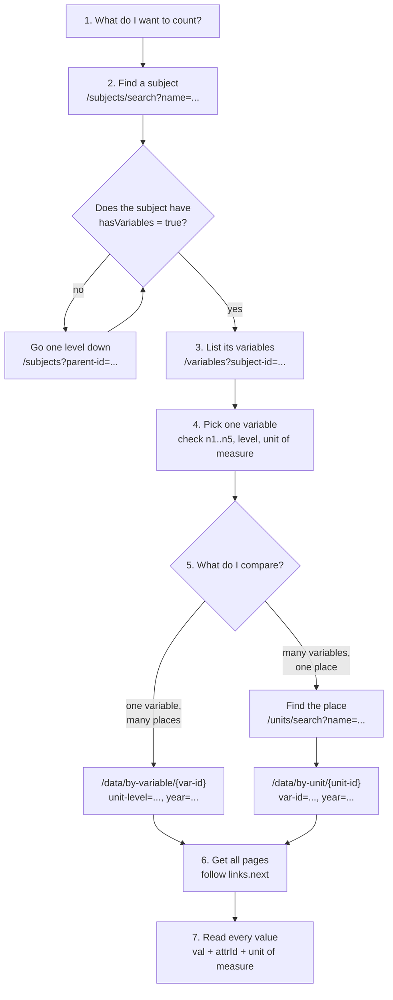

# BDL API: a step-by-step guide

This guide explains how to get numbers out of the BDL API (Bank Danych Lokalnych,
the Local Data Bank of Statistics Poland, GUS). It assumes you know nothing about it.

Responses below come from the live API and are shortened.

## 1. The whole idea in one sentence

> You **find a variable** (what you want to count), **pick places and years**
> (where and when), **download the values**, and **read each value together with
> its flag** (whether the number can be trusted as a normal number).

That is all. Everything else in the API helps you do one of these four things.

## 2. An analogy

Think of BDL as a library:

| Library | BDL | Example |
| --- | --- | --- |
| Section of the library | **Subject** (`K...`, `G...`) | `K3` Population |
| Shelf | **Subject** with variables (`P...`) | `P1330` Voivodeship councillors by sex and age |
| One table on a page | **Variable** (number) | `3643` councillors, both sexes, aged 30-39 |
| Row of the table | **Territorial unit** | `011200000000` Małopolskie |
| Column of the table | **Year** | `2023` |
| One cell | **Value** + **attribute** | `val: 0`, `attrId: 0` |

You walk from the section to the shelf, take one table, and read the cells you need.

## 3. The map

Follow the arrows from top to bottom. There is only one real choice (the diamond
"What do I compare?").



Statistical localities (villages, parts of towns, level 7) use the same map with
`/data/localities/...` and `/units/localities/...` instead.

## 4. Words you need (and nothing more)

- **Subject**: a folder. Subjects form a tree. Only the lowest folders (IDs starting
  with `P`) contain variables. You know you reached one when `hasVariables` is `true`.
- **Variable**: one exact thing that is counted, identified by a number. Its name is
  split into pieces `n1`...`n5` (for example `n1` = sex, `n2` = age). The pieces only
  make sense together with the subject's `dimensions`.
- **Territorial unit**: a place (Poland, a voivodeship, a county, a municipality...).
  Its ID is a 12-character **text**, not a number. Never strip the leading zero.
- **Level**: what kind of place. A number from 0 to 7 (see the cheat sheet).
- **Value**: the number itself, in the field `val`.
- **Attribute** (`attrId`): a flag on every value that tells you what the number means
  (normal value, estimate, confidential, not available yet...).
- **Unit of measure**: what the number counts (persons, PLN, km²...).

## 5. Walkthrough with real data

Goal: *How many voivodeship councillors aged 30-39 were there in 2023?*

### Step 1. Find the subject

```http
GET https://bdl.stat.gov.pl/api/v1/subjects/search?name=radni&format=json
```

Search by a word from the subject name. The source data is Polish, so Polish words
are a safe choice; add `lang=en` to get English names in the response.

**Warning:** search returns many results. For example `name=population` with
`lang=en` returned 262 subjects. Read the names and pick one; do not just take the
first result.

We pick subject `P1330`:

```http
GET https://bdl.stat.gov.pl/api/v1/subjects/P1330?format=json&lang=pl
```

```json
{
  "id": "P1330",
  "parentId": "G5",
  "name": "Radni województwa wg płci i wieku",
  "hasVariables": true,
  "dimensions": ["Płeć", "Wiek"],
  "availability": [{ "year": "2023", "levels": [3], "quarterly": "R" }],
  "description": "Dane wg stanu w dniu 31 grudnia."
}
```

What this tells you:

- `hasVariables: true`, so this is a shelf with tables. Go to step 2.
- `dimensions` says each variable is split by **sex** (`Płeć`) and **age** (`Wiek`).
- `availability` says data for 2023 exists at **level 3**. Remember this number.
- `"R"` means yearly data.
- `description` says the values are as of 31 December.

If `hasVariables` were `false`, you would list its children instead:

```http
GET https://bdl.stat.gov.pl/api/v1/subjects?parent-id=G7&format=json
```

A real branch of the tree looks like this:

```text
K3  POPULATION
└── G7  (one of: G7, G8, G10, G534, G535, G564, G655)
    ├── P2137  Population by sex and age group      hasVariables = true
    ├── P2462  Population by sex (half-yearly data) hasVariables = true
    └── ...
```

You can also start at the top with `/subjects` (no parameters) and walk down.

### Step 2. List the variables of the subject

```http
GET https://bdl.stat.gov.pl/api/v1/variables?subject-id=P1330&format=json
```

You get a list. Each item is one combination of the dimensions (for example
"men, 30-39", "women, 30-39", "both sexes, 30-39"...). Read `n1`...`n5` and pick one.

### Step 3. Check the chosen variable

```http
GET https://bdl.stat.gov.pl/api/v1/variables/3643?format=json&lang=pl
```

```json
{
  "id": 3643,
  "subjectId": "P1330",
  "n1": "ogółem",
  "n2": "30-39",
  "level": 3,
  "measureUnitId": 26,
  "measureUnitName": "osoba",
  "years": [1999, 2000, 2001, 2023, 2024, 2025]
}
```

(`years` is shortened; the real list contains every year from 1999 to 2025.)

Read it with the subject's `dimensions` next to it:

| Field | Value | Meaning |
| --- | --- | --- |
| `n1` | `ogółem` | Sex = both sexes |
| `n2` | `30-39` | Age = 30 to 39 |
| `level` | `3` | Data is collected for regions |
| `measureUnitName` | `osoba` | The number counts persons |
| `years` | `1999`...`2025` | Years for which the variable exists |

So variable `3643` = "voivodeship councillors, both sexes, aged 30-39, in persons".

### Step 4a. One variable for many places

```http
GET https://bdl.stat.gov.pl/api/v1/data/by-variable/3643?unit-level=3&year=2023&page-size=1&format=json&lang=pl
```

(`page-size=1` is used here only to keep the example short.)

```json
{
  "totalRecords": 17,
  "links": {
    "first": "...&page=0&page-size=1",
    "self": "...&page=0&page-size=1",
    "next": "...&page=1&page-size=1",
    "last": "...&page=16&page-size=1"
  },
  "variableId": 3643,
  "measureUnitId": 26,
  "aggregateId": 1,
  "lastUpdate": null,
  "results": [
    {
      "id": "011210000000",
      "name": "REGION MAŁOPOLSKIE",
      "values": [{ "year": "2023", "val": 0, "attrId": 0 }]
    }
  ]
}
```

- `totalRecords: 17` means 17 **places** in total, not 17 numbers.
- Only one of them came back. The rest are on the next pages (`links.next`).
- Each place has a list `values`, one item per requested year.

### Step 4b. Many variables for one place

First find the place:

```http
GET https://bdl.stat.gov.pl/api/v1/units/search?name=małopolskie&format=json
```

Then ask for the variables you want (repeat `var-id` for each one):

```http
GET https://bdl.stat.gov.pl/api/v1/data/by-unit/011200000000?var-id=3643&year=2023&format=json
```

```json
{
  "totalRecords": 1,
  "unitId": "011200000000",
  "unitName": "MAŁOPOLSKIE",
  "aggregateId": 1,
  "results": [
    {
      "id": 3643,
      "measureUnitId": 26,
      "lastUpdate": "2026-05-08T13:36:47.723",
      "values": [{ "year": "2023", "val": 0, "attrId": 0 }]
    }
  ]
}
```

It is the same data turned around: now `results` are **variables**, not places.

### Step 5. Read the answer

For each value, read three things together:

1. `val`: the number, here `0`.
2. `attrId`: the flag, here `0`. Look it up in `/attributes`; `0` means zero.
3. Unit of measure: `osoba` (persons), from the variable.

Answer: in 2023 the value for Małopolskie is 0 persons, and the flag says it is a
zero, not missing or confidential data.

## 6. Which route do I take?

| I want to... | Use | Example |
| --- | --- | --- |
| Compare voivodeships on one indicator | `/data/by-variable/{var-id}` + `unit-level=2` | map, ranking, chart |
| Compare counties inside one voivodeship | `/data/by-variable/{var-id}` + `unit-level=5` + `unit-parent-id=...` | regional chart |
| Show many indicators for one municipality | `/data/by-unit/{unit-id}` + many `var-id` | profile page |
| Get data for statistical localities | `/data/localities/by-variable/{var-id}` + `unit-parent-id=...` | local detail |

## 7. Cheat sheets

### Levels (`unit-level`, `level`)

| Number | Place |
| ---: | --- |
| 0 | Poland |
| 1 | Macroregion |
| 2 | Voivodeship (województwo) |
| 3 | Region |
| 4 | Subregion |
| 5 | County (powiat) |
| 6 | Municipality (gmina) |
| 7 | Statistical locality (miejscowość statystyczna) |

Voivodeship (2) and region (3) are **different levels** with different IDs, for
example `011200000000` MAŁOPOLSKIE and `011210000000` REGION MAŁOPOLSKIE.

### Attributes (`attrId`) worth knowing

The full list is at `/attributes`. The ones that change how you read a number:

| `attrId` | Meaning |
| ---: | --- |
| 0 | Zero |
| 1 | Normal value |
| 3 | Total may be incomplete |
| 4 | No data, or confidential (statistical secrecy) |
| 7 | Value smaller than the display precision (not a real zero) |
| 9 | Preliminary estimate |
| 11 | Methodology changed |
| 13 | Methodology changed; total may be incomplete |
| 14 | Methodology changed; no data or confidential |
| 15 | No data because units or variables changed |
| 17 | Methodology changed; value smaller than the display precision |
| 20, 21 | Low-precision data |
| 50 | Not available yet, will be published |
| 91 | No data, or confidential (same description as 4) |
| 94 | Meaningful zero (for example births equal deaths) |
| 97 | County and city with county rights combined |
| 98 | Methodology changed; meaningful zero |

**`val: 0` does not always mean zero.** Always check `attrId`.

The `/attributes` dictionary has `id`, `name`, `symbol`, and `description`.
Names are often just `"0"` or `"wartość"` (value): use the description and symbol,
not the name alone, to interpret the flag. Empty descriptions and a single-space
symbol are valid. `/measures` has `id`, `name`, and `description`. Both dictionaries
are paginated. A single page of each, checked on 2026-11-25, contained all 18
attributes and 76 measures respectively.

The DataHandler backend exposes cached `/attributes` and `/measures` endpoints.
Its `/data/by-variable/{id}` response is an object containing `measureUnit`
(`id`, `name`), nullable `lastUpdate`, and `units`. Each value includes
`attributeId`, `attributeName`, `attributeDescription`, and `attributeSymbol`.
This is the backend's normalized contract, not the upstream BDL response shape.
See [the backend README](../backend/README.md#bdl-dictionaries-and-data-metadata).

### Aggregates (`aggregate-id`)

Usually leave it out; the default is `1` (total). Others select a part of the
total, for example `2` urban municipalities, `4` rural municipalities, `7` towns,
`8` rural areas. The full list is at `/aggregates`.

### Common parameters

| Parameter | Meaning | Example |
| --- | --- | --- |
| `format` | `json`, `xml` or `jsonapi` | `format=json` |
| `lang` | Language of names: `pl` or `en` | `lang=en` |
| `year` | Years; repeat for more | `year=2022&year=2023` |
| `var-id` | Variables; repeat for more | `var-id=3643&var-id=2137` |
| `unit-level` | Which kind of place | `unit-level=5` |
| `unit-parent-id` | Only places inside this one | `unit-parent-id=011200000000` |
| `page` | Page number, starts at **0** | `page=0` |
| `page-size` | Items per page, default 10 | `page-size=100` |

Lists are sent by **repeating** the parameter, not with commas.

## 8. Traps

1. **Forgetting pages.** The first response is often not everything. Keep following
   `links.next` until it is missing.
2. **Reading `val` without `attrId`.** See the attributes table.
3. **Treating unit IDs as numbers.** `011200000000` becomes `11200000000` and breaks.
4. **Mixing up voivodeship and region.** Levels 2 and 3 are different.
5. **Trusting `n1`...`n5` alone.** Read them with the subject's `dimensions`.
6. **Asking for a level or year that does not exist.** Check the subject's
   `availability` and the variable's `level` and `years` first.
7. **The official schema does not match the real responses.** Write code against
   real responses:

   | Swagger / ReDoc / PDF says | The API actually returns |
   | --- | --- |
   | `value` | `val` |
   | `firstPage`, `nextPage`, `lastPage` | `first`, `next`, `last` |
   | Limit error `{ "result", "reason" }` | `{ "errorResult": "..." }` |
   | `pageSize`, `subjectId` (PDF only) | `page-size`, `subject-id` |

## 9. Limits

| Period | Anonymous | With a free key |
| --- | ---: | ---: |
| 1 second | 5 | 10 |
| 15 minutes | 100 | 500 |
| 12 hours | 1,000 | 5,000 |
| 7 days | 10,000 | 50,000 |

All periods apply at the same time. The key goes in the `X-ClientId` HTTP header.

When you exceed a limit, the API answers like this:

```http
HTTP/1.1 429 Too Many Requests
Retry-After: 19605 sec
```

```json
{ "errorResult": "API calls quota exceeded! Maximum admitted 1000 per 12 h." }
```

Anonymous requests from one machine (for example the backend and manual
experiments in the same Codespace) appear to share one quota.

Successful responses carry `X-Rate-Limit-Remaining` (requests left) and
`X-Rate-Limit-Reset` (when the counter resets), so you can see how close you are.

## 10. Official sources

- [BDL API home page](https://api.stat.gov.pl/Home/BdlApi): introduction, limits,
  registration, examples.
- [Swagger UI](https://bdl.stat.gov.pl/api/v1/swagger/index.html): try requests in
  the browser.
- [ReDoc](https://bdl.stat.gov.pl/api/v1/api-docs/index.html): the same
  specification, easier to read.
- [Method description (PDF)](https://api.stat.gov.pl/Content/files/bdl/Opis_metod_API_BDL_v1.pdf):
  all methods and terms of use (some parameter names are outdated).
- [OpenAPI specification (JSON)](https://bdl.stat.gov.pl/api/v1/swagger/doc/swagger.json):
  machine-readable version.

Data is published under the CC BY 4.0 license, which requires attribution to GUS.
